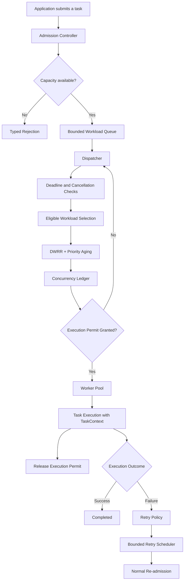
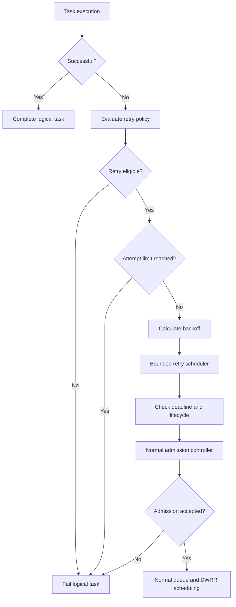
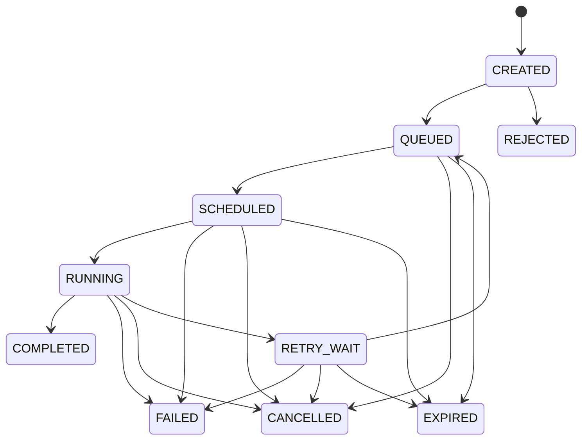

# FlowGate

### Control the flow. Allocate the power.

**A Java workload admission and scheduling framework for applications that need predictable, fair, and bounded execution.**

[](#technology-stack)
[](#building)
[](#testing-and-verification)
[](#project-roadmap)
[](#architecture)
[](#license)

**One process. One shared execution budget. Multiple workloads.**

FlowGate introduces controlled admission, weighted fair scheduling, centralized resource allocation, deadline management, and policy-driven retries into Java application execution.

---

## 1. Introduction

Modern Java applications rarely execute just one kind of work. A typical backend application may simultaneously process transactional operations, authentication requests, notifications, reporting jobs, scheduled tasks, and background data processing.

Although these workloads execute within the same application, they do not necessarily have the same execution requirements. Some are latency-sensitive, some are resource-intensive, and others can tolerate delays. Nevertheless, they frequently compete for the same finite resources: worker threads, execution slots, memory, and queue capacity.

Traditional asynchronous execution provides mechanisms for running tasks concurrently, but it does not automatically establish a workload-level resource allocation policy.

This is the problem FlowGate is designed to address.

**FlowGate is an in-process workload admission and execution scheduling framework for Java applications.** It sits between task submission and execution, managing how work enters the system, where accepted work waits, which workload receives execution opportunities, and how shared concurrency is allocated.

Instead of treating all incoming tasks as an undifferentiated stream, FlowGate organizes them into independently configured workloads.

Each workload has its own bounded queue, scheduling weight, priority, and execution constraints. A centralized resource ledger coordinates access to the global execution budget, while the scheduler distributes execution opportunities across eligible workloads.

The framework also incorporates deadline-aware task handling and bounded retries that re-enter normal admission rather than bypassing the execution-control system.

The intended result is a more controlled execution environment in which overload, fairness, resource contention, and failure handling are explicit parts of the architecture.

## 2. The Problem FlowGate Addresses

Consider a backend application that handles four categories of work:

| Workload | Characteristics | Execution requirement |
|---|---|---|
| Payments | Transactional and time-sensitive | High importance and protected capacity |
| Authentication / OTP | Latency-sensitive operations | Prompt execution |
| Notifications | Bursty background processing | Controlled resource consumption |
| Reports / Analytics | Potentially long-running operations | Fair progress without monopolizing execution |

A conventional shared executor can execute all these tasks, but a shared execution facility alone does not establish how resources should be distributed between these workloads.

For example, imagine the reporting subsystem suddenly receives thousands of tasks. If all workloads share one queue, reporting traffic can consume a significant portion of the available pending-work capacity. Payment operations may then experience increased waiting time despite being more important to the application.

Increasing the thread-pool size does not necessarily solve the underlying problem. It increases potential concurrency but does not introduce workload isolation, fair scheduling, or a resource reservation policy.

Similarly, adding separate executors for every workload can introduce another problem: fragmented resource allocation. One executor may be saturated while another has unused threads, with no centralized mechanism to coordinate their shared execution budget.

Retries can make the situation worse. If failed tasks are immediately resubmitted without considering existing admission limits, retry traffic can amplify an already overloaded system.

FlowGate approaches these problems as a unified workload-coordination problem.

It aims to answer four fundamental questions:

1. **Admission:** Should incoming work be accepted given the currently available capacity?
2. **Scheduling:** Which eligible workload should receive the next execution opportunity?
3. **Allocation:** How much shared execution capacity can that workload consume?
4. **Lifecycle:** How should deadlines, cancellation, failures, retries, and shutdown affect accepted work?

These responsibilities are separated into individual components but coordinated through a common runtime.

## 3. Core Design Philosophy

FlowGate is built around the distinction between accepting work and executing work.

A task should not automatically consume execution resources simply because an application has submitted it. First, the framework must establish whether the system has sufficient admission capacity. Once accepted, the task waits in its designated workload queue until the scheduler selects it and the concurrency ledger grants an execution permit.

This separation creates two important resource boundaries.

**Pending-work capacity** determines how much accepted work can accumulate.

**Execution capacity** determines how much work can run simultaneously.

These are different resources and should be managed independently.

The framework also separates scheduling fairness from resource allocation. The scheduler decides which eligible workload deserves the next opportunity; the concurrency ledger determines whether that workload can actually consume another execution slot.

This separation makes the system easier to reason about and prevents scheduling policy from becoming entangled with concurrency accounting.

The overall design follows a simple principle:

> Make resource consumption explicit, make execution decisions controlled, and keep the internal coordination machinery independent of application business logic.

## 4. Architecture

FlowGate follows a layered architecture consisting of admission control, workload queues, scheduling, resource allocation, execution, and lifecycle management.

### 4.1 High-level execution flow



### 4.2 Component responsibilities

**Admission Controller**

The admission controller is the entry point for task submission. It validates the requested workload, checks the runtime's admission state, and attempts to reserve both global and workload-level queue capacity.

A successful reservation means the framework has accepted responsibility for the task's pending execution. If admission cannot be completed, the submission is rejected with an explicit outcome.

This prevents the application from accumulating unlimited accepted work inside FlowGate.

**Workload Queues**

Every configured workload has its own bounded queue. This separates pending work according to its workload identity and prevents one workload from directly consuming another workload's queue capacity.

The queues are responsible for holding accepted tasks, not deciding their execution priority or granting concurrency.

**Dispatcher**

The dispatcher coordinates the movement of tasks from workload queues to worker execution.

It identifies eligible workloads, consults the scheduling policy, checks deadline and cancellation conditions, requests execution permits from the concurrency ledger, and hands successfully scheduled tasks to the worker pool.

The dispatcher acts as the coordination point between scheduling and execution without taking ownership of the ledger's resource-accounting rules.

**DWRR Scheduler**

The scheduling engine implements Deficit Round Robin. It distributes scheduling opportunities according to configured workload weights and maintains deficit accounting across scheduling rounds.

Its responsibility is selecting workloads fairly, not managing worker capacity.

**Priority Aging**

Priority aging adjusts effective scheduling priority based on waiting time, subject to configured limits. Its purpose is to reduce the risk of prolonged starvation when higher-priority work continues to arrive.

**Concurrency Ledger**

The ledger is the authoritative component for execution capacity. It manages the global execution budget, per-workload maximums, reservations, borrowing eligibility, and execution permits.

**Worker Pool**

The worker pool executes application-provided task logic on reusable threads. It does not decide admission or workload fairness.

**Deadline Manager**

The deadline manager identifies overdue queued tasks and coordinates their expiration. Running tasks can inspect deadline state through their execution context.

**Retry Scheduler**

The retry scheduler manages delayed retry attempts without occupying worker threads during backoff. Once the delay completes, the task must re-enter normal admission.

**Task State Machine**

The task state machine coordinates lifecycle transitions atomically. It ensures that competing operations such as cancellation, dispatch, expiration, and retry do not independently move a task into conflicting states.

## 5. Admission Control and Bounded Workload Queues

Admission control is the first major resource boundary in FlowGate.

When an application submits a task, FlowGate checks whether the requested workload exists and whether the required admission capacity is available.

Two limits are considered:

- Global pending-work capacity.
- Per-workload queue capacity.

A task must successfully obtain the required reservation before it can become accepted work.

This is important because a queue's configured capacity should represent an actual limit, not merely a preferred size.

### Why bounded admission matters

An unbounded queue can hide overload rather than solve it. If the rate of incoming work consistently exceeds the rate of execution, pending tasks accumulate, memory consumption increases, and task latency can become unpredictable.

FlowGate treats admission as an explicit decision. When capacity is exhausted, additional work is rejected instead of being silently accumulated.

This gives the application a meaningful opportunity to apply its own overload response, such as returning an error, applying upstream backpressure, or informing the caller that capacity is unavailable.

A successful admission does not guarantee immediate execution. It guarantees that the task has entered the framework under its configured capacity constraints.

### Reservation correctness

Queue admission uses a reservation-and-commit model.

A successful reservation must be followed by exactly one of two outcomes:

1. The reservation is committed by enqueueing the task.
2. The reservation is rolled back if enqueueing cannot be completed.

This prevents failed submissions from permanently consuming admission capacity.

## 6. Resource Allocation: Reserved Concurrency and Borrowing

One of FlowGate's central architectural features is its centralized concurrency ledger.

The ledger exists because queue capacity and execution capacity represent different resource constraints.

A workload may have enough queue capacity to accept more tasks while already operating at its maximum execution concurrency. Conversely, a workload may have unused execution capacity even when other workloads are waiting.

FlowGate manages these conditions separately.

### 6.1 Resource model

For each workload \(q\), the configuration defines:

| Parameter | Meaning |
|---|---|
| `capacity(q)` | Maximum pending admitted work |
| `reserved(q)` | Reserved execution concurrency |
| `max(q)` | Maximum simultaneous executions |
| `weight(q)` | Relative scheduling weight |
| `priority(q)` | Configured workload importance |
| `defaultDeadline(q)` | Default task deadline |

Let \(G\) represent the global execution concurrency budget.

The system must satisfy:

\[
\sum_q a(q) \leq G
\]

Each workload must also satisfy:

\[
0 \leq a(q) \leq max(q)
\]

Here, \(a(q)\) represents the currently active executions for workload \(q\).

### 6.2 Example: shared execution budget

Suppose an application has a global concurrency budget of 20.

| Workload | Reserved concurrency | Maximum concurrency | Weight |
|---|---:|---:|---:|
| Payments | 8 | 12 | 5 |
| OTP | 4 | 8 | 3 |
| Notifications | 2 | 8 | 2 |
| Reports | 2 | 6 | 1 |
| **Total reservations** | **16** | — | — |

The reservation values represent execution capacity that the ledger protects for workloads when they have eligible waiting work.

Suppose payments currently use only three of their eight reserved execution slots. The unused reservation can make room for other eligible workloads to execute, provided the borrowing rules and their own maximums permit it.

If payment demand subsequently increases, the ledger changes its borrowing decisions so that new allocations do not consume capacity required to honor the reservation model.

### 6.3 Why borrowing is necessary

Strictly partitioning the global execution budget into independent workload allocations can result in poor utilization.

For example, if the reporting workload has no pending tasks, its reserved capacity could remain idle while notifications are waiting.

Borrowing allows eligible workloads to use otherwise available execution capacity without permanently transferring ownership of reservations.

There is an important limitation: FlowGate does not forcibly terminate or preempt already-running borrowed tasks.

Consequently, a reservation is enforced through allocation decisions and available capacity, not through instant reclamation of running execution slots.

### 6.4 Allocation authority

The concurrency ledger is the only authority responsible for granting execution permits.

The scheduler cannot grant a permit simply because a workload has been selected. The workload must independently satisfy the ledger's allocation rules.

This makes concurrency accounting centralized and prevents independent scheduling components from accidentally exceeding the global execution budget.

## 7. Scheduling: Deficit Weighted Round Robin

FlowGate uses **Deficit Round Robin (DWRR)** as its weighted fair scheduling foundation.

The objective is to distribute execution opportunities across workloads while respecting their configured weights.

A workload with a higher weight should receive a larger relative share of scheduling opportunities than a workload with a lower weight, assuming comparable eligibility and sustained demand.

### 7.1 Why not simple round robin?

A simple round-robin scheduler gives workloads equal scheduling opportunities.

That is not always desirable in applications where workloads have different service importance or expected resource shares.

For example, an application may want payment processing to receive more scheduling opportunities than background reporting.

DWRR introduces a configurable quantum for each workload and maintains a deficit value across scheduling rounds. The deficit represents scheduling credit that influences when a workload can receive an execution opportunity.

This provides weighted scheduling without requiring the scheduler to maintain one globally sorted collection of all individual tasks.

### 7.2 Priority aging

Weighted fairness and priority are related but different concerns.

Weight determines the relative scheduling share of a workload. Priority represents the configured importance of its work.

FlowGate complements these concepts with priority aging.

When a task remains waiting, its effective scheduling priority can improve according to the configured aging interval and maximum boost.

This is intended to reduce starvation under sustained contention without removing the distinction between configured workload priorities.

### 7.3 Separation from concurrency allocation

The scheduling system answers:

*Which eligible workload should receive the next scheduling opportunity?*

The concurrency ledger answers:

*Can that workload acquire another execution slot right now?*

This separation allows the scheduling algorithm and resource-allocation policy to evolve independently while preserving a consistent execution budget.

## 8. Deadline Management and Cooperative Cancellation

FlowGate supports deadline-aware task execution.

A deadline represents the latest time at which a task remains eligible for execution under its configured deadline.

Deadline calculations use a monotonic time source. This avoids relying on wall-clock adjustments when measuring elapsed time.

### Queued tasks

Queued tasks are checked for deadline expiration during dispatch and through a periodic deadline sweeper.

The sweeper provides eager expiration so overdue work does not need to wait indefinitely for another scheduling opportunity before being recognized as expired.

Once a queued task is expired, the appropriate lifecycle transition is applied and its associated queue capacity is released.

### Running tasks

A running task can inspect its `TaskContext` to determine whether a deadline exists, whether the deadline has elapsed, how much time remains, and whether cancellation has been requested.

This gives application code a way to respond to deadlines and cancellation while executing.

### Why cancellation is cooperative

Java does not provide a safe general mechanism for forcibly terminating arbitrary application code running on a thread.

Interrupting a thread does not guarantee that the code will stop. A task may be blocked in non-interruptible code, ignore interrupts, or continue performing external side effects.

FlowGate therefore exposes cancellation and deadline state rather than promising forced termination.

Application tasks should periodically inspect their execution context and cooperate with cancellation where prompt termination is required.

## 9. Retry Engine: Bounded and Policy-Driven Re-admission

Retries are a natural part of failure handling, but they can create additional load during an already overloaded period.

A system that immediately resubmits failed tasks without considering admission capacity can amplify the original problem.

FlowGate treats retries as another stage of the task lifecycle.

### 9.1 Retry policy

Retry behavior is controlled through a configurable policy.

It supports maximum attempts, retry classification, exponential backoff, a maximum delay, and optional jitter.

The retry policy determines whether a failure is eligible for another execution attempt and calculates the delay before that attempt can be scheduled.

Retry behavior is disabled by default, so workloads do not retry unexpectedly unless explicitly configured.

### 9.2 Why retries do not sleep on worker threads

A worker thread should execute application work, not remain occupied while waiting for a retry delay.

Sleeping inside a worker during backoff reduces available execution capacity and can make an overloaded system even less responsive.

FlowGate instead uses a bounded delayed retry scheduling mechanism.

The delayed retry is managed separately from worker execution. When the delay completes, the task attempts to re-enter normal admission.

### 9.3 Why retries re-enter normal admission

A retry is not allowed to bypass queue limits or receive an unconditional execution slot.

After its backoff period, it must compete for admission under the same global and per-workload capacity rules as new submissions.

This prevents retry traffic from creating a hidden backlog outside the framework's normal admission controls.

If capacity is unavailable, the retry follows an explicit terminal outcome rather than accumulating indefinitely in an unbounded internal queue.

### 9.4 Logical task identity

A retry is another execution attempt of the same logical task, not a new independent task.

FlowGate preserves the logical task ID and completion future across attempts. The original deadline remains authoritative, and cancellation remains applicable while the task is waiting for another attempt.

Intermediate failures do not complete the logical task's future.

The attempt limit includes the initial execution. For example, a maximum of three attempts means one initial execution and up to two retries.

### 9.5 Retry lifecycle



The retry system therefore remains integrated with admission, scheduling, resource accounting, deadlines, cancellation, and runtime shutdown.

## 10. Task Lifecycle and Atomic State Management

FlowGate models task execution through an explicit state machine.



Each state represents a meaningful stage in the logical task's lifecycle.

For example, `QUEUED` means the task has been admitted but has not yet been selected for execution. `SCHEDULED` represents the transition from queue selection toward worker execution. `RETRY_WAIT` indicates that an eligible failure has entered the delayed retry stage.

Terminal states include completion, failure, cancellation, expiration, and rejection.

Transitions are guarded atomically. This matters because several events can race against one another. A dispatcher might attempt to schedule a task while another thread requests cancellation, or a deadline sweeper might attempt to expire a task that has already been selected.

The state machine ensures that competing transitions have a well-defined winner rather than allowing conflicting terminal outcomes.

This is an important part of FlowGate's concurrency correctness.

## 11. Engineering Principles

The implementation follows several principles that guide architectural decisions.

**Boundedness over uncontrolled accumulation.** Every accepted workload and delayed retry must operate within explicit capacity constraints. Overload should be visible rather than hidden in growing queues.

**One authority for execution permits.** The concurrency ledger owns execution capacity. Other components may request permits, but they do not independently modify resource accounting.

**Scheduling and allocation remain separate.** Fairness determines execution opportunity; resource accounting determines whether that opportunity can be used.

**No hidden preemption.** Borrowed capacity does not imply forcibly terminating running tasks to reclaim reservations.

**Cooperative task control.** Running application code must participate in deadline and cancellation handling.

**Atomic lifecycle transitions.** Concurrent events must not produce ambiguous task states or duplicate terminal completion.

**Retries must respect admission.** Retried work is subject to the same capacity constraints as newly submitted work.

**Test invariants, not just examples.** Concurrency correctness requires testing capacity accounting, race conditions, state transitions, and repeated concurrent operations.

**Simple adoption, sophisticated internals.** The long-term developer experience should expose a small and intuitive API while keeping scheduling and resource-management complexity internal.

## 12. Project Roadmap

FlowGate is being developed incrementally. Each milestone establishes a tested foundation before the next layer is introduced.

GitHub task-list checkboxes indicate implementation progress.

- [x] **M0 — Core Foundations**
  
  Established the initial Maven project structure and core domain model. Introduced the monotonic time abstraction, task status model, atomic lifecycle state machine, priority representation, configuration records, and configuration validation. This milestone established the common types and invariants used by later execution components.

- [x] **M1 — Admission Control and Bounded Queues**
  
  Introduced global admission control and independently bounded workload queues. Implemented queue reservation, enqueue commit, rollback, queue registration, and submission handling. This milestone established the first resource boundary: accepted pending work must fit within configured global and workload capacity.

- [x] **M2 — Resource Allocation and Concurrency Ledger**
  
  Introduced the centralized concurrency ledger to manage global and per-workload execution limits. Added reserved concurrency, controlled borrowing, execution eligibility, and idempotent execution permits. This milestone separated execution capacity from queue capacity and established a single authority for allocating worker slots.

- [x] **M3 — Weighted Scheduling and Runtime Integration**
  
  Introduced Deficit Round Robin scheduling and connected admission, workload queues, concurrency allocation, dispatcher, and worker execution into a functioning runtime. Added scheduling eligibility, weighted quantum accounting, and lifecycle coordination. This milestone transformed the individual infrastructure components into an integrated execution engine.

- [x] **M4 — Deadline Management and Priority Aging**
  
  Added deadline-aware execution, a periodic deadline sweeper, eager expiration of queued work, and cooperative deadline visibility for running tasks. Integrated priority aging into scheduling so waiting work can receive bounded priority improvements. Also strengthened runtime startup and shutdown handling.

- [x] **M5 — Bounded, Policy-Driven Retry Engine**
  
  Added configurable retry classification, bounded attempt counts, exponential backoff, optional jitter, and delayed retry scheduling. Integrated retries into the existing task lifecycle while preserving logical task identity and completion future. Retry attempts re-enter normal admission, ensuring that retry traffic remains subject to queue limits, scheduling, concurrency allocation, deadlines, cancellation, and shutdown behavior.

- [ ] **M6 — Public API and Developer Experience**
  
  Focuses on making FlowGate straightforward to integrate into ordinary Java applications. The objective is to provide a developer-facing facade, fluent configuration, sensible defaults, clear submission results, and simple task interaction without exposing internal scheduling or concurrency machinery.

- [ ] **M7 — Observability and Metrics**
  
  Introduces visibility into workload execution and resource allocation. Planned work includes workload-level statistics, admission and rejection metrics, queue visibility, concurrency utilization, and integration with established metrics systems such as Micrometer.

- [ ] **M8 — Workload Simulation and Integration**
  
  Introduces representative workload simulations to evaluate FlowGate under mixed traffic, different priorities, bursty submissions, long-running operations, and failure scenarios. The goal is to demonstrate practical behavior and provide measurable evidence for scheduling and resource-allocation decisions.

- [ ] **M9 — Documentation and Release Hardening**
  
  Focuses on comprehensive API documentation, integration examples, compatibility review, release verification, architectural review, and final stabilization of the core library.

The roadmap describes intended development direction. Features in unchecked milestones are not current implementation guarantees.

## 13. Current Implementation Status

The current implementation is a single-JVM, in-memory Java runtime.

The core execution path now includes admission control, bounded workload queues, centralized concurrency allocation, DWRR scheduling, priority aging, worker execution, deadline management, and policy-driven retries.

These components operate as an integrated system rather than isolated utilities.

### Implemented capabilities

| Area | Current implementation |
|---|---|
| Admission | Global and per-workload bounded admission |
| Queueing | Concurrent bounded workload queues |
| Resource accounting | Central concurrency ledger |
| Reservations | Reserved execution concurrency |
| Borrowing | Controlled use of available execution capacity |
| Scheduling | Deficit Round Robin |
| Priority | Priority-aware aging |
| Execution | Dispatcher and reusable worker pool |
| Deadlines | Queued-task expiration and cooperative running visibility |
| Cancellation | Atomic lifecycle transitions and cooperative running visibility |
| Retries | Bounded policy-driven retries |
| Retry scheduling | Delayed retries and normal re-admission |
| Lifecycle | Runtime startup and coordinated shutdown |

### Deliberately outside the current core

The following capabilities are planned for later development and should not be assumed to exist in the current implementation.

| Capability | Intended direction |
|---|---|
| Spring Boot starter | v1.1 |
| Micrometer integration | v1.1 |
| Additional scheduling algorithms such as EDF/WFQ | v1.2 |
| Optional caller-runs backpressure | v1.1 |
| Tenant hierarchy | v1.2 |
| Adaptive concurrency | Later v1.x |
| Persistence and distributed coordination | v2 direction |

The current implementation does not provide durable task storage, cross-process coordination, distributed scheduling, circuit breakers, or adaptive concurrency estimation.

## 14. Positioning Within the Java Ecosystem

FlowGate operates in an area related to Java concurrency utilities, executor frameworks, and resilience libraries. However, its primary abstraction is workload-level admission and execution coordination.

Understanding this distinction is important when evaluating where the framework belongs.

### Java ExecutorService and ThreadPoolExecutor

Java's `ExecutorService` provides a standard abstraction for executing tasks asynchronously and managing executor lifecycle. `ThreadPoolExecutor` adds configurable worker limits, queueing, and rejection behavior.

These are fundamental execution primitives.

FlowGate builds a higher-level coordination model around these primitives. It introduces independently bounded workloads, weighted scheduling, workload-level concurrency constraints, reservations, and controlled borrowing.

An executor primarily manages how submitted tasks are executed by a pool. FlowGate manages how competing workloads are admitted and allocated execution opportunities before and during that execution.

FlowGate is not intended to replace Java's executor infrastructure. It uses Java concurrency mechanisms to implement workload-level policies.

### Resilience4j

[Resilience4j](https://github.com/resilience4j/resilience4j) provides composable fault-tolerance patterns including circuit breakers, retries, rate limiters, bulkheads, and time limiters.

Its central concern is protecting application operations against failures and adverse conditions.

FlowGate's central concern is coordinating competing workloads and their consumption of shared execution capacity.

These are complementary concerns. For example, an application can use FlowGate to manage a payment-processing workload and Resilience4j to protect its external payment-provider calls with circuit-breaker and retry policies.

### Failsafe

[Failsafe](https://github.com/failsafe-lib/failsafe) provides composable execution policies for retries, timeouts, circuit breakers, fallbacks, and related failure-handling behavior.

FlowGate does not aim to replace a general-purpose execution-policy composition library.

Its retry mechanism is integrated into workload admission and scheduling. A retry must re-enter the normal admission pathway and compete for capacity under the same workload constraints.

### Netflix Concurrency Limits

[Netflix concurrency-limits](https://github.com/Netflix/concurrency-limits) focuses on dynamically estimating and controlling concurrency limits to improve latency and throughput under changing load.

FlowGate currently uses configured global and per-workload concurrency limits, reservations, and borrowing.

It does not currently claim to provide adaptive concurrency estimation or automatic feedback-based tuning.

### Comparison of primary abstractions

| Capability | FlowGate | Resilience4j / Failsafe | ExecutorService |
|---|---|---|---|
| Workload-level admission | Core focus | Not primary abstraction | Basic submission |
| Bounded workload queues | Per-workload | Not primary abstraction | Executor-level queue |
| Weighted scheduling | DWRR | Not primary abstraction | Not built in |
| Priority aging | Yes | Not primary abstraction | Not built in |
| Reserved workload concurrency | Yes | Different bulkhead abstractions | Not built in |
| Central concurrency allocation | Core focus | Operation-level controls | Pool-level limits |
| Deadline management | Yes | Timeout policies | No general workload deadline manager |
| Policy-driven retries | Yes | Yes | No |
| Retry re-admission through workload control | Yes | Not primary abstraction | No |
| Circuit breaker | Not currently | Yes | No |
| Adaptive concurrency | Not currently | Not primary focus | No |

This comparison describes the primary abstractions and capabilities of each approach. It is not a claim that other libraries cannot be combined with additional components to implement similar behavior.

**FlowGate is intended to complement execution and resilience libraries rather than replace them.**

## 15. What FlowGate Is Not

FlowGate is deliberately scoped as an in-process execution coordination framework.

It is not a distributed task queue, message broker, workflow orchestration engine, or replacement for systems such as Kafka and RabbitMQ.

It does not currently provide persistent task storage or recovery of pending work after a JVM restart. Its queues and scheduling state exist in memory within one runtime instance.

It is also not a general-purpose circuit breaker, rate limiter, reactive framework, or automatic CPU and memory resource manager.

These boundaries are important because workload scheduling inside one JVM and distributed task orchestration across machines are fundamentally different architectural problems.

FlowGate's current focus is to solve the former correctly before introducing additional infrastructure complexity.

## 16. Execution Guarantees and Limitations

FlowGate's design provides explicit resource boundaries, but these should not be confused with guarantees it does not make.

| Area | Behavior |
|---|---|
| Admission | Bounded global and per-workload capacity |
| Queueing | In-memory bounded queues |
| Scheduling | Weighted DWRR with priority aging |
| Concurrency | Centralized global and workload-level limits |
| Reservations | Protected through ledger allocation decisions |
| Borrowing | Controlled use of available capacity |
| Preemption | No forced termination of running tasks |
| Deadlines | Eager queued expiration and cooperative running visibility |
| Cancellation | State-based cancellation and cooperative running visibility |
| Retries | Bounded and subject to normal re-admission |
| Durability | In-memory only |
| Distribution | Single JVM |

Weighted fairness does not guarantee strict FIFO ordering across workloads or a fixed task start time.

Admission acceptance does not guarantee immediate execution.

A retry is not guaranteed to be readmitted if capacity is unavailable.

A deadline does not guarantee forced termination of non-cooperative Java code.

These are deliberate execution semantics rather than implementation oversights.

## 17. Technology Stack

FlowGate is implemented using standard Java concurrency facilities and is designed to avoid unnecessary infrastructure dependencies in its core.

| Area | Technology |
|---|---|
| Programming language | Java 17+ |
| Build system | Apache Maven |
| Testing | JUnit 5 |
| Concurrency | Java concurrency utilities |
| State transitions | Atomic state management |
| Queueing | Bounded concurrent queue structures |
| Scheduling | Deficit Round Robin |
| Resource allocation | Central concurrency ledger |
| Deadline tracking | Monotonic time source |
| Retry timing | Scheduled execution with bounded retry capacity |

The project is developed using newer JDK versions while targeting Java 17-compatible source settings.

The current core does not require Spring Boot, a database, Redis, or a message broker.

## 18. Building the Project

### Requirements

- JDK 17 or newer.
- Apache Maven 3.8+ recommended.
- Git.

### Clone

```bash
git clone https://github.com/Y-1328/FlowGate.git
cd FlowGate
```

### Build and verify

Run the following command from the Maven parent project directory:

```bash
mvn clean verify
```

This performs a clean compilation and executes the project's verification lifecycle, including the configured test suite.

To execute only the tests:

```bash
mvn clean test
```

To build the core module:

```bash
mvn -pl flowgate-core clean package
```

To package without executing tests:

```bash
mvn clean package -DskipTests
```

The recommended verification command during development is `mvn clean verify`, since it ensures that the build is not relying on stale compiled classes.

## 19. Repository Structure

FlowGate currently uses a Maven parent project with a dedicated core module.

```text
FlowGate/
|
+-- pom.xml
|
+-- flowgate-core/
    |
    +-- pom.xml
    |
    +-- src/
        |
        +-- main/
        |   |
        |   +-- java/
        |       |
        |       +-- io/flowgate/
        |           |
        |           +-- api/
        |           +-- config/
        |           +-- policy/
        |           |
        |           +-- internal/
        |               |
        |               +-- admission/
        |               +-- deadline/
        |               +-- dispatch/
        |               +-- ledger/
        |               +-- queue/
        |               +-- retry/
        |               +-- runtime/
        |               +-- task/
        |               +-- time/
        |
        +-- test/
            |
            +-- java/
```

The API, configuration, and policy packages contain developer-facing abstractions and configuration types.

The internal packages implement the admission, scheduling, dispatch, resource allocation, retry, deadline, lifecycle, and task execution machinery.

The separation is intended to keep application integration independent from the internal implementation details.

## 20. Testing and Verification

Concurrency libraries require more than happy-path tests. Their correctness depends on how they behave under simultaneous operations, resource contention, failures, and lifecycle races.

FlowGate's test strategy therefore focuses on invariants rather than only checking whether individual methods return expected values.

The test suite covers configuration validation, queue capacity, admission reservation and rollback, concurrency ledger accounting, permit acquisition and release, DWRR scheduling, priority aging, deadline expiration, cancellation, retry behavior, runtime integration, and shutdown coordination.

It also includes model-based and concurrency-oriented tests intended to detect violations of resource-accounting and lifecycle guarantees.

### Latest verified M5 checkpoint

| Metric | Result |
|---|---:|
| Tests executed | **330** |
| Failures | **0** |
| Errors | **0** |
| Skipped | **0** |
| Maven result | **BUILD SUCCESS** |

This represents the reported M5 verification result. Passing the current test suite provides evidence for the tested behaviors; it is not a formal proof of every possible thread interleaving or production workload.

Run `mvn clean verify` locally to verify the current repository state.

## 21. Contributing

FlowGate is under active development, and technical feedback is welcome.

Contributions involving scheduling policies, resource accounting, lifecycle correctness, API usability, documentation, and testing are particularly relevant to the project's direction.

For substantial architectural changes, open an issue before implementation so that design implications and compatibility can be discussed.

When submitting changes:

1. Keep changes focused on a specific behavior or invariant.
2. Add tests for concurrency and lifecycle edge cases.
3. Run `mvn clean verify`.
4. Document public API changes and behavioral trade-offs.
5. Preserve boundedness and resource-accounting guarantees.
6. Avoid making internal packages part of the supported public API without an explicit design decision.

## 22. License

**No license has been selected yet.**

Until a `LICENSE` file is added, do not assume that others have permission to use, modify, or redistribute this project.

A license will be selected before the first public release.

---

<div align="center">

### FlowGate

**Control the flow. Allocate the power.**

*Built around a simple question: when every workload wants resources, how should an application decide who gets to run?*

</div>

## Competitive Benchmark Results

Initial comparative simulation — 24 November 2026.

FlowGate was evaluated against a bounded JDK ThreadPoolExecutor across nine measured scenarios.

### Reports
- [Interactive HTML Report](report.html)
- [Markdown Report](report.md)
- [Benchmark Metrics](scenario_metrics.csv)
- [Raw Event Data](combined_events.csv)
- [Metrics JSON](metrics.json)

### Initial Findings
- Competitive performance in several scenarios.
- Higher throughput in SIM-05 and SIM-08.
- Lower P95 latency in SIM-02 and SIM-08.
- SIM-03 identified as the main performance investigation target.

This is an initial two-adapter comparison, not proof of universal performance superiority. Additional adapters and resource/fairness measurements remain future work.

