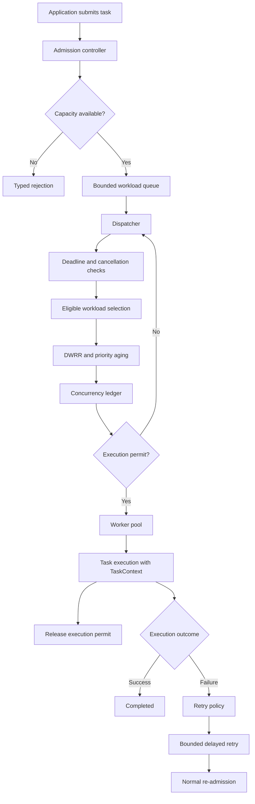

<div align="center">

# FlowGate

### Control the flow. Allocate the power.

**A Java workload admission and scheduling framework for predictable, fair, and bounded in-process execution.**

[](https://www.java.com/)
[](https://maven.apache.org/)
[](#testing-and-verification)
[](#scope-and-limitations)
[](LICENSE)

<p>
  <a href="https://github.com/Y-1328/FlowGate"></a>
  <a href="https://github.com/Y-1328/FlowGate/issues"></a>
  <a href="https://github.com/Y-1328/FlowGate/tree/main/flowgate-core"></a>
</p>
<p>
  <a href="benchmark-results/initial-comparison/report.html"></a>
  <a href="docs/technical/FlowGate_Technical_Documentation.pdf"></a>
</p>

**One process. One shared execution budget. Multiple workloads.**

[Overview](#overview) · [Architecture](#architecture) · [Core capabilities](#core-capabilities) · [Build](#build-and-verify) · [Benchmarks](#initial-benchmark) · [Branches](#project-layout-and-branches)

</div>

---

## Overview

Modern Java applications often execute several kinds of work at once: transactional operations, authentication requests, notifications, reports, scheduled jobs, and background processing. These workloads compete for finite resources, but they do not necessarily have the same latency, priority, or capacity requirements.

**FlowGate is an in-process workload admission and execution scheduling framework.** It sits between task submission and execution and coordinates:

- whether work can enter the runtime;
- where accepted work waits;
- which eligible workload receives the next execution opportunity;
- how shared concurrency is allocated; and
- how deadlines, cancellation, failures, retries, and shutdown affect task lifecycle.

Instead of treating incoming work as one undifferentiated stream, FlowGate organizes it into independently configured workloads with bounded queues and workload-level execution constraints.

## The problem FlowGate addresses

A shared executor can run tasks concurrently, but a shared execution facility alone does not define a workload-level allocation policy. A burst of reporting jobs can occupy pending-work capacity while latency-sensitive operations are waiting. Creating a separate executor for every workload can fragment capacity, leaving one pool saturated while another has idle workers.

FlowGate treats this as a workload-coordination problem and separates four decisions:

| Concern | FlowGate responsibility |
|---|---|
| **Admission** | Accept or reject work against global and per-workload pending capacity. |
| **Scheduling** | Select an eligible workload using weighted scheduling and priority aging. |
| **Allocation** | Grant execution permits within global and per-workload concurrency limits. |
| **Lifecycle** | Coordinate deadlines, cooperative cancellation, failures, bounded retries, and shutdown. |

## Core capabilities

| Capability | Description |
|---|---|
| Bounded admission | Global and per-workload queue capacity with reservation, commit, and rollback. |
| Workload isolation | Separate bounded queues for independently configured workloads. |
| Weighted scheduling | Deficit Round Robin (DWRR) distributes scheduling opportunities according to workload weights. |
| Priority aging | Waiting work can receive bounded priority improvements to reduce starvation risk. |
| Central concurrency ledger | One authority manages global and per-workload execution permits. |
| Reservations and borrowing | Workloads have reserved and maximum concurrency; eligible work can use otherwise available capacity under ledger rules. |
| Deadline management | Queued work can expire eagerly; running tasks can inspect deadline state. |
| Cooperative cancellation | Tasks can observe cancellation and deadline state through their execution context. |
| Bounded retries | Configurable retry classification, attempt limits, backoff, maximum delay, and optional jitter. |
| Normal re-admission | Retry attempts re-enter standard admission instead of bypassing queue and concurrency controls. |
| Atomic lifecycle | State transitions coordinate competing dispatch, cancellation, expiration, and retry events. |

## Architecture

FlowGate separates admission, scheduling, resource allocation, and execution so that each component has one clear responsibility.



### Design principles

1. **Boundedness over uncontrolled accumulation.** Overload should be visible through admission outcomes rather than hidden in growing queues.
2. **One authority for execution permits.** The concurrency ledger owns execution capacity; the scheduler does not allocate it independently.
3. **Scheduling and allocation remain separate.** Fairness chooses an opportunity; the ledger decides whether it can be used.
4. **Retries respect admission.** Retry traffic competes under the same workload constraints as new work.
5. **Cooperative task control.** Running Java code must cooperate with deadline and cancellation signals.
6. **Simple adoption, sophisticated internals.** The developer-facing API should not require application code to manage the internal scheduling machinery.

## Public API

The Core module exposes a developer-facing API, including the `FlowGate` facade and `QueueBuilder` configuration entry point. The goal is to let an application configure workloads and submit tasks without directly coordinating the internal admission controller, dispatcher, scheduler, or concurrency ledger.

For the current API surface and implementation, browse [`flowgate-core/src/main/java/io/flowgate/api`](flowgate-core/src/main/java/io/flowgate/api).

## Project layout and branches

The repository is intentionally organized so the **`main` branch is the Core foundation**. Examples and the benchmark simulation are developed on separate branches, each based on `main` and therefore containing the same Core source.

### `main` — Core

```text
FlowGate/
├── README.md
├── LICENSE
├── .gitignore
├── pom.xml
├── docs/
│   ├── benchmark/
│   └── technical/
├── benchmark-results/
│   └── initial-comparison/
│       ├── report.html
│       ├── report.md
│       ├── metrics.json
│       ├── scenario_metrics.csv
│       ├── combined_events.csv
│       └── charts/
└── flowgate-core/
    ├── pom.xml
    └── src/
        ├── main/java/
        └── test/java/
```

### Feature branches

<p>
  <a href="https://github.com/Y-1328/FlowGate/tree/feature/examples"></a>
  <a href="https://github.com/Y-1328/FlowGate/tree/feature/simulation"></a>
</p>

- **`feature/examples`** adds the `flowgate-examples` Maven module to the Core project.
- **`feature/simulation`** adds the `flowgate-simulation` benchmark runner, scenario catalog, adapters, and report-generation scripts to the Core project.

These links are intended for the feature branches in this repository; they become available after those branches have been published.

## Build and verify

### Requirements

- JDK 17 or newer.
- Apache Maven 3.8 or newer recommended.
- Git.

### Clone

```bash
git clone https://github.com/Y-1328/FlowGate.git
cd FlowGate
```

### Verify the Core project

Run from the repository root:

```bash
mvn clean verify
```

Other useful commands:

```bash
# Run Core tests
mvn -pl flowgate-core test

# Package the Core module
mvn -pl flowgate-core clean package
```

The root Maven reactor on `main` includes **only `flowgate-core`**. The Examples and Simulation modules are maintained in their respective feature branches.

## Initial benchmark

An initial comparative simulation evaluated FlowGate against a bounded JDK `ThreadPoolExecutor` baseline across nine measured scenarios (SIM-01 to SIM-08 and SIM-10).

<p>
  <a href="benchmark-results/initial-comparison/report.html"></a>
  <a href="benchmark-results/initial-comparison/report.md"></a>
</p>

### Selected observations

| Scenario | FlowGate throughput/s | JDK throughput/s | FlowGate P95 ms | JDK P95 ms | Observation |
|---|---:|---:|---:|---:|---|
| SIM-02 | 88.03 | 88.10 | **301.906** | 310.298 | Similar throughput; lower FlowGate P95. |
| SIM-03 | 424.28 | **560.74** | 438.071 | **364.968** | Main FlowGate throughput and latency investigation target. |
| SIM-05 | **73.08** | 71.56 | 16.100 | 16.112 | FlowGate has a small throughput advantage. |
| SIM-08 | **558.65** | 547.02 | **414.979** | 442.999 | FlowGate has higher throughput and lower P95; JDK completed four more tasks. |
| SIM-10 | **70.23** | 70.06 | **16.130** | 16.413 | Very similar results. |

The full scenario table, charts, and task-outcome data are in the [HTML report](benchmark-results/initial-comparison/report.html) and [Markdown report](benchmark-results/initial-comparison/report.md).

### Benchmark scope and limitations

- Only FlowGate and bounded JDK `ThreadPoolExecutor` have been measured so far. Resilience4j, Failsafe, Netflix concurrency-limits, and Reactor are not measured adapters in this report.
- SIM-09 cancellation pressure is skipped.
- CPU, memory, allocation, GC, fairness, and recovery metrics are not instrumented in this initial comparison.
- The separately exported raw event CSV did not independently reconcile to the summary metrics during report preparation. Treat the CSV as supplementary until it is regenerated and reconciled; use the published HTML/Markdown summary as the reported comparison snapshot.
- The results are an initial comparison, not proof that FlowGate is universally faster than executor or resilience libraries.

## Testing and verification

The Core verification run recorded on 24 November 2026 completed with:

| Metric | Result |
|---|---:|
| Tests executed | **425** |
| Failures | **0** |
| Errors | **0** |
| Skipped | **0** |
| Maven result | **BUILD SUCCESS** |

The tests cover configuration, admission reservation and rollback, queue capacity, concurrency-ledger accounting, permit acquisition and release, DWRR scheduling, priority aging, deadlines, cancellation, retry behavior, runtime integration, and lifecycle/shutdown races. Passing the suite is evidence for the tested cases, not a formal proof of every possible thread interleaving or production workload.

## Scope and limitations

FlowGate is currently a **single-JVM, in-memory execution coordination framework**.

- It is not a distributed task queue, message broker, workflow orchestrator, or replacement for Kafka or RabbitMQ.
- It does not persist queued tasks or recover pending work after a JVM restart.
- It does not coordinate scheduling across multiple processes.
- It does not forcibly preempt or terminate arbitrary running Java code. Deadlines and cancellation for running work are cooperative.
- It is not a circuit breaker, general-purpose rate limiter, or adaptive concurrency controller.

FlowGate is designed to complement Java executors and resilience libraries: it focuses on workload-level admission and execution coordination rather than replacing the underlying execution primitives or all fault-tolerance policies.

## Technical documentation

- [FlowGate technical documentation (PDF)](docs/technical/FlowGate_Technical_Documentation.pdf)
- [BT02 executable test notes](docs/technical/BT02_Executable_README.md)
- [Initial benchmark analysis](docs/benchmark/INITIAL-COMPARISON.md)

## License

FlowGate is distributed under the [Apache License 2.0](LICENSE).

---

<div align="center">

**FlowGate — Control the flow. Allocate the power.**

*When every workload wants resources, how should an application decide who gets to run?*

</div>
